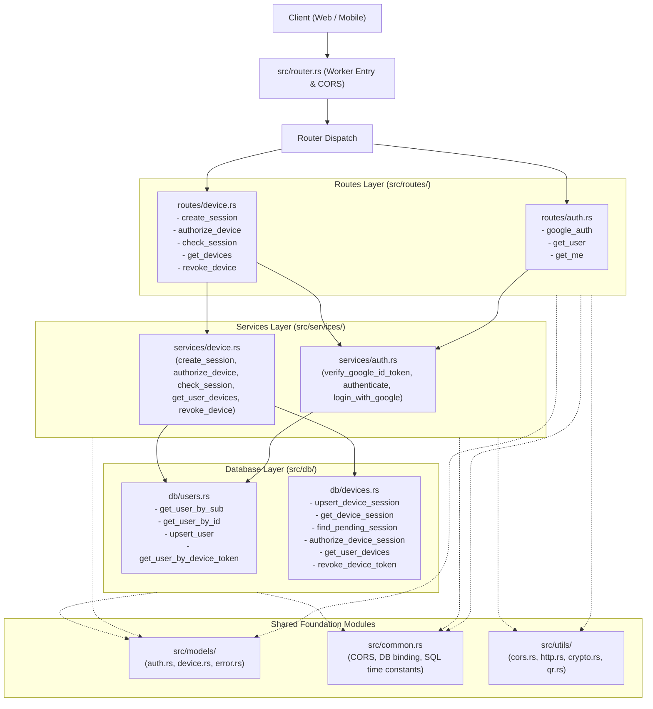

# Backend Architecture

## 1. Overview

The backend is built as a high-performance, serverless Cloudflare Worker written in **Rust** using the [`worker`](https://crates.io/crates/worker) crate (v0.8) and compiled to WebAssembly (Wasm). It utilizes Cloudflare **D1** (SQLite) for users and long-lived device tokens, plus one **Durable Object** per pairing session (`PairingObject`, 2-minute life) as the pairing referee and push channel.

The codebase follows the **Model-Service-Route (MSR / MSC)** architectural pattern, strictly separating configuration, reusable utilities, domain data models, business logic services, database operations, and HTTP route handlers into dedicated module folders.

---

## 2. Directory Structure

```
backend/
├── Cargo.toml
├── wrangler.toml
├── schema.sql
├── architecture.md
└── src/
    ├── common.rs              # Global configuration, constants, and SQL time expressions
    ├── router.rs              # Worker entry point and router dispatch
    │
    ├── utils/                 # Reusable helper utilities
    │   ├── mod.rs             # Module declarations & re-exports
    │   ├── cors.rs            # CORS origins, request origin parser, preflight
    │   ├── http.rs            # Bearer token extractor, JSON response helpers
    │   ├── crypto.rs          # Cryptographic secure token generator, 128-hex validator
    │   ├── jwt.rs             # HS256 session JWT mint/verify (pure, unit-tested)
    │   └── qr.rs              # Fast QR SVG renderer
    │
    ├── objects/               # Durable Objects
    │   ├── mod.rs             # Module declarations & re-exports
    │   ├── device.rs          # DeviceObject: real-time WebSocket revocation push
    │   ├── pairing.rs         # PairingObject: pairing state, alarm, WebSocket push
    │   └── state.rs           # Pure pairing state machine & transition rules
    │
    ├── db/                    # D1 database repository layer
    │   ├── mod.rs             # Module declarations & re-exports
    │   ├── helper.rs          # D1Type parameter mapping helpers
    │   ├── users.rs           # User lookup, upsert, and device-token JOIN queries
    │   └── devices.rs         # Pairing-code index, device token insert/delete, revocation
    │

    ├── models/                # Domain models, database structs, and request/response DTOs
    │   ├── mod.rs             # Module declarations
    │   ├── auth.rs            # User entity, Google OAuth profiles, DTOs
    │   ├── device.rs          # PairingCode, PairingState, DeviceToken, and pairing/check DTOs
    │   └── error.rs           # AppError and AppResult
    │
    ├── services/              # Pure business logic layer
    │   ├── mod.rs             # Module declarations & re-exports
    │   ├── auth.rs            # AuthService (Google OAuth verification, unified auth, user lookups)
    │   ├── device.rs          # DeviceService (QR session creation, authorization, check, revoke push)
    │   ├── pairing.rs         # DoPairingClient / DoDeviceNotifier (Worker → object stubs)
    │   ├── store.rs           # PairingStore / PairingClient / DeviceNotifier seams
    │   └── validation.rs      # Pure input validation & normalization
    │
    └── routes/                # HTTP endpoint handlers
        ├── mod.rs             # Shared route context helpers (e.g., get_db)
        ├── auth.rs            # /api/auth/google, /api/users/:sub, /api/auth/me
        └── device.rs          # /api/auth/device/*, /api/devices, /api/devices/ws/:token, /api/devices/:token
```

---

## 3. Architecture Layers



### Layer Details

1. **`src/common.rs` (Constants & Configuration)**
   - Single source of truth for global configuration:
     - CORS settings (`DEFAULT_ORIGINS`, `ALLOWED_METHODS`, `ALLOWED_HEADERS`, `CORS_MAX_AGE`).
     - Cloudflare D1 binding name (`DB_BINDING_NAME = "dashboard"`).
     - SQLite time expressions (`SQL_NOW`, `SESSION_EXPIRY_SQL`, `TOKEN_EXPIRY_SQL`).
     - Session constraints (`SESSION_ID_HEX_LEN = 128`, `SHORT_CODE_LEN = 6`).

2. **`src/utils/` (Reusable Utilities Folder)**
   - **`cors.rs`**: `allowed_origins`, `request_origin`, `apply_cors`, `cors_preflight`.
   - **`http.rs`**: `bearer_token`, `json_ok`, `json_error`.
   - **`crypto.rs`**: `generate_secure_token` (cryptographically secure random hex via `getrandom`), `is_valid_128_hex`.
   - **`qr.rs`**: `generate_qr_svg` (fast_qr SVG renderer).

3. **`src/db/` (Database Repository Folder)**
   - **`helper.rs`**: `text_or_null` parameter mapper.
   - **`users.rs`**: Prepared statements for users (`get_user_by_sub`, `get_user_by_id`, `upsert_user`, and single-query `INNER JOIN` lookup `get_user_by_device_token`).
   - **`devices.rs`**: Prepared statements for the pairing-code index (`upsert_pairing_code`, `get_pairing_code`, `find_session_by_code`) and device tokens (`insert_device_token`, `delete_device_token`, `get_user_devices`, `revoke_device_token`).

4. **`src/models/` (Data Models & DTOs Folder)**
   - **`error.rs`**: `AppError` and `AppResult<T>`, encapsulating HTTP status codes and error messages with standard JSON formatting.
   - **`auth.rs`**: Database `User` entity, `GoogleProfile`, `TokenInfo` deserializer, and request/response DTOs (`GoogleAuthRequest`, `UserResponse`).
   - **`device.rs`**: `DeviceSession`, `DeviceToken` entities, and DTOs (`CreateSessionRequest`, `CreateSessionResponse`, `AuthorizeDeviceRequest`, `AuthorizeDeviceResponse`, `CheckSessionRequest`, `CheckSessionResponse`, `DevicesResponse`, `RevokeResponse`).

5. **`src/services/` (Business Logic Folder)**
   - Decoupled from HTTP request and response objects.
   - **`auth.rs` (`AuthService`)**:
     - `verify_google_id_token`: Validates tokens against Google's tokeninfo API, checks expiration and `GOOGLE_CLIENT_ID` audience.
     - `login_with_google`: Verifies Google ID tokens and provisions or updates user rows in D1.
     - `authenticate`: Unified authentication engine supporting server-minted session JWTs and mobile device tokens only.
     - `get_user_by_sub`: Retrieves user records by Google subject ID.
   - **`device.rs` (`DeviceService`)**:
     - `create_session`: Validates 128-hex session IDs, generates QR code SVG, extracts short codes, and persists pending sessions.
     - `authorize_device`: Links pending sessions to authenticated users, issues 6-month device tokens, and updates session states.
     - `check_session`: Polling status inspection, returning device tokens upon authorization and detecting session expiration dynamically.
     - `get_user_devices`: Lists active devices for the user.
     - `revoke_device`: Revokes device tokens.

6. **`src/routes/` (HTTP Endpoints Folder)**
   - Parses request JSON into strongly typed DTOs, extracts route parameters and headers, delegates to services, and returns formatted responses.
   - **`auth.rs`**: Handles `/api/auth/google`, `/api/users/:sub`, `/api/auth/me`.
   - **`device.rs`**: Handles `/api/auth/device/session`, `/api/auth/device/authorize`, `/api/auth/device/check`, `/api/devices`, `/api/devices/:token`.
   - **`mod.rs`**: Context utilities like `get_db`.

7. **`src/router.rs` (Worker Entry Point & Router Dispatch)**
   - Intercepts OPTIONS requests for CORS preflight.
   - Defines the Worker fetch event handler and registers routes with `Router::new()`.
   - Applies CORS headers to all outbound responses.

---

## 4. Authentication Flow

### Web Google OAuth (JWT session)
1. Frontend receives Google ID token (`credential`) and keeps it only in memory.
2. Calls `POST /api/auth/google` with `{ "credential": "<token>" }` — the only route that accepts a Google token.
3. `AuthService::login_with_google` validates token with Google's tokeninfo endpoint, upserts the user in D1, and mints a 60-minute HS256 session JWT (`JWT_SECRET`).
4. Returns `{ "user": ..., "token": "<jwt>", "expires_at": <unix millis> }`. The frontend stores the JWT (never the Google credential) and sends it as `Authorization: Bearer <jwt>` on every other route.
5. `AuthService::authenticate` accepts exactly two credentials: the session JWT (with `uid` cross-checked against the user row) or a mobile device token. Google ID tokens and raw `google_sub` values are rejected.

### Mobile QR Code Device Pairing
1. Mobile app generates a 128-character hex session ID.
2. Calls `POST /api/auth/device/session` with `{ "session_id": "<hex>" }`.
3. Backend writes the slim D1 code index (`code -> session_id`, 2 minutes), initializes the session's `PairingObject` as `pending` with a 2-minute alarm, and returns the SVG QR code and 6-character shortcode.
4. Mobile displays QR and opens `GET /api/auth/device/ws/:session_id` (hibernatable WebSocket proxied to the object). No polling and no tap needed; `POST /api/auth/device/check` remains as the reconnect/manual fallback (small circular button on mobile).
5. Web dashboard user scans QR (or enters shortcode) and calls `POST /api/auth/device/authorize` with their session JWT. Failed authorization attempts (e.g., invalid code, expired session, or conflict) are delayed by 5 seconds to deter brute-force guessing; successful authorizations respond immediately.
6. Backend resolves the code via the D1 index, confirms `pending` with the object, generates a 64-character cryptographically secure device token (valid for 180 days), inserts it into D1 `device_tokens`, then commits to the object. The object flips to `authorized`, persists the result for replay, pushes `{ "status": "authorized", "token": "<device_token>", "user": {...} }` once, and closes. A lost commit race deletes the just-minted token (compensation) and returns 409.
7. Mobile receives the push (or the replay on reconnect / fallback check), stores `device_token`, and authenticates subsequent requests via `Authorization: Bearer <device_token>`.
8. At 2 minutes the alarm expires a still-pending object (pushes `expired`, wipes on completion); the D1 index row expires on the same clock.

### Real-Time Device Revocation
1. Authorized mobile device opens `GET /api/devices/ws/:token` to connect a hibernatable WebSocket to its dedicated `DeviceObject` (`idFromName(device_token)`).
2. When the user clicks "Revoke" on the web dashboard, the web app sends `DELETE /api/devices/:token` with their session JWT.
3. Backend authenticates the user, deletes the device token from D1 `device_tokens`, and pokes `DeviceObject` via `POST /revoke`.
4. `DeviceObject` broadcasts `{"status": "revoked", "message": "Device access was revoked from the web dashboard."}` to the connected WebSocket and immediately closes the socket.
5. Mobile receives the message, wipes `device_token` from `localStorage`, displays the revocation alert banner, and starts a fresh pairing session displaying a new QR code.

---

## 5. Build and Verification Commands

```bash
# Check code syntax and type-checking
cargo check

# Run linter
cargo clippy -- -D warnings

# Build release WebAssembly bundle
worker-build --release
```

---

## 6. Local vs Production Database

- **Local dev** (`make start-api`, i.e. `wrangler dev --local` with no `--env`
  flag) resolves the `dashboard` D1 binding to a Miniflare-backed local D1 —
  plain SQLite files under `backend/.wrangler/state/`. The remote D1 instance
  is never touched. First-time setup: `make db-schema-local`.
- **Production** (`make deploy-api`, i.e. `wrangler deploy --env production`)
  binds the same `dashboard` binding to the remote Cloudflare D1 instance
  (`wrangler.toml` `[env.production]` inherits the top-level D1 binding and
  sets `ENVIRONMENT = "production"`; local default is `ENVIRONMENT = "dev"`).
  Apply schema changes with `make db-schema-prod`.
- **Rule:** never use `--remote` from a dev shell, and never deploy without
  `--env production`.

---

## Pre-PR Review Contract (Draft)

> Grill interview record. Status: **Draft** — no section becomes Final without
> explicit user acceptance. Target document itself is still unconfirmed;
> `architecture.md` is the provisional holder because it is the only existing
> backend doc (root `readme.md` is the alternative).

### Settled

- Review target is the local working tree before a PR is raised (branch
  `main`, nothing staged), not a hosted PR. There is no open PR associated
  with `main`.

### Unresolved

- Target document confirmation (`architecture.md` vs root `readme.md`).
- Artifact boundary: backend-only vs whole working tree; how to treat deleted
  Bun backend files vs new untracked Rust backend files; frontend/mobile
  exclusion.
- Done means (observable completion checklist).
- Review depth and output form (what the review must cover and produce).
- Constraints, risks, validation.

---

## Durable Object Pairing Migration (Draft)

> Grill interview record. Status: **Draft** — no decision becomes Final
> without explicit user acceptance. Provisional holder is this file
> (`backend/architecture.md`), the only existing backend doc; root
> `readme.md` is the alternative target (still unconfirmed, see above).

### Current logic (inspected)

- Mobile generates a 128-hex `session_id`, calls
  `POST /api/auth/device/session`; backend derives the 6-char `short_code`
  from `session_id[..6]`, upserts a `pending` row in D1 `device_sessions`
  (15 min expiry, `schema.sql`), and returns QR SVG + `short_code`.
- Web dashboard (Google JWT) calls `POST /api/auth/device/authorize` with
  the 6-char code (or full `session_id` from QR); backend resolves the
  pending row by `session_id = ? OR lower(short_code) = ?`, mints a
  180-day `device_token`, batch-writes `device_tokens` + marks the
  session `authorized` (guarded `status='pending'` update, 409 on race).
- Mobile learns the result only by calling
  `POST /api/auth/device/check` with its `session_id`. Today that call is
  manual: `useDeviceAuth.checkAuth()` is bound to the **Check for Auth**
  button (`DeviceInstructionsCard.vue`). There is no polling loop, no
  WebSocket, and no Durable Object in the codebase. Architecture §4
  step 4 says "polls", but the code does not poll — that is the gap.
- `device_tokens` + `users` in D1 remain the long-lived source of truth;
  only the ephemeral pairing handshake is a Durable Object candidate.

### Gap to fill

- After web authorization succeeds, mobile stays on `pending` until the
  user taps **Check for Auth**. Goal: mobile logs in automatically when
  authorization lands, with simple, clean code and no test changes in
  this pass (per requester constraint, to be confirmed in scope).

### Settled

- Q1 — Fallback and button: **keep `POST /check` and keep the button**.
  Durable Object push becomes the primary auto-login path; `check`
  remains the reconnect/background/manual fallback. The full-width
  **Check for Auth** button is demoted to a smaller circular icon
  button, properly aligned (secondary affordance, not the main CTA).
  Source: user reply `1` in grill session, 2026-10-16.
- Q2 — Addressing: **reuse D1 as the phone book**. Authorization keeps
  today's D1 lookup (`code -> session_id`, pending/expiry/409 guards
  and token write unchanged), then pokes the Durable Object named by
  the resolved `session_id` to push to mobile. No registry object,
  and the object is never named by the guessable 6-char code.
  Source: user reply `1` in grill session, 2026-10-16.
  **Revisit required:** Q3 (below) removes the D1 table this lookup
  reads, so the `code -> session_id` translation needs a new home
  (see Q3b). The "never name the object by the 6-char code" part
  stands.
- Q3 — Source of truth: **Durable Object replaces `device_sessions`**.
  Pairing state (pending/authorized/expired) moves into the object's
  own storage with a 2-minute expiry alarm; D1 keeps only `users`
  and long-lived `device_tokens`. Session creation, authorization,
  and check move to the object. This supersedes the "D1 lookup
  unchanged" half of Q2 and needs Q3b to stay workable.
  Source: user reply `2` in grill session, 2026-10-16.
- Q3b — Code translation: **tiny D1 index, object referees**. One
  slim D1 pointer table (`code, session_id, expires_at`) translates
  the 6-char code to the session; status/expiry/race decisions live
  in the Durable Object, never in the index. No registry object.
  Source: user reply `1` in grill session, 2026-10-16.
- Legacy: **ignore it — greenfield project**. No migration of
  in-flight `device_sessions`, no dual-read/backward compatibility,
  no deprecation window. The old table and its queries can be
  removed outright and replaced. Source: user, 2026-10-16.

- Q4 — Transport: **hibernatable WebSocket per session, one-shot
  push, then close**. Mobile connects with its full `session_id`;
  the object `acceptWebSocket`s (hibernation), waits, and on
  authorization flips pending -> authorized, persists the result
  until expiry for replay/reconnect, pushes
  `{status, token, user}` once, and closes. Worker keeps JWT check,
  token mint, and `device_tokens` write; the object never handles
  credentials. Missed push is recovered via reconnect replay or the
  `POST /check` fallback reading the same object. Expiry is
  **2 minutes** (changed from today's 15): alarm pushes `expired`
  to a still-pending session, closes, and wipes object storage;
  the D1 index row expires on the same 2-minute clock. Device
  token lifetime (180 days) unchanged.
  Source: user reply `1, change timer to 2 mins`, 2026-10-16.

- Scope contract: **accepted**. In scope: backend Durable Object +
  WebSocket route, `wrangler.toml` binding, `schema.sql` swap
  (`device_sessions` -> slim index), 2-minute expiry; mobile socket
  auto-login, step copy, small circular check button; web frontend
  untouched. Out of scope: tests (no create/change), legacy
  migration/compat, registry object, persistent post-login socket,
  Google auth, device list/revoke. Done means: (1) untouched mobile
  auto-logs in on web authorization, (2) circular button manual
  check still succeeds, (3) pending session expires at 2 minutes on
  both sides, (4) `cargo check` + `cargo clippy -- -D warnings`
  pass and manual `wrangler dev` flow verified. Existing tests
  faking the old D1 session store may break until a later pass —
  accepted debt. Source: user reply `accept`, 2026-10-16.

### Unresolved

- None. Decision tree exhausted; implementation plan follows in
  conversation. This section stays **Draft** (Final only on later
  explicit user instruction).

### Implementation

- Implemented per the accepted scope after user `go` (2026-10-16):
  `PairingObject` + WebSocket push, slim D1 `pairing_codes` index,
  2-minute expiry, mobile auto-login with circular fallback button.
  The "Current logic (inspected)" above is the pre-change record.
