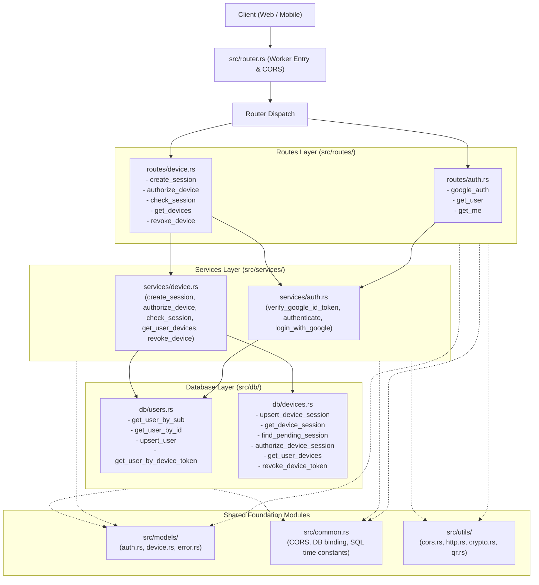

# Backend Architecture

## 1. Overview

The backend is built as a high-performance, serverless Cloudflare Worker written in **Rust** using the [`worker`](https://crates.io/crates/worker) crate (v0.8) and compiled to WebAssembly (Wasm). It utilizes Cloudflare **D1** (SQLite) as its primary database.

The codebase follows the **Model-Service-Route (MSR / MSC)** architectural pattern, strictly separating configuration, reusable utilities, domain data models, business logic services, database operations, and HTTP route handlers into dedicated module folders.

---

## 2. Directory Structure

```
backend/
├── Cargo.toml
├── wrangler.toml
├── schema.sql
├── architecture.md
└── src/
    ├── common.rs              # Global configuration, constants, and SQL time expressions
    ├── router.rs              # Worker entry point and router dispatch
    │
    ├── utils/                 # Reusable helper utilities
    │   ├── mod.rs             # Module declarations & re-exports
    │   ├── cors.rs            # CORS origins, request origin parser, preflight
    │   ├── http.rs            # Bearer token extractor, JSON response helpers
    │   ├── crypto.rs          # Cryptographic secure token generator, 128-hex validator
    │   ├── jwt.rs             # HS256 session JWT mint/verify (pure, unit-tested)
    │   └── qr.rs              # Fast QR SVG renderer
    │
    ├── db/                    # D1 database repository layer
    │   ├── mod.rs             # Module declarations & re-exports
    │   ├── helper.rs          # D1Type parameter mapping helpers
    │   ├── users.rs           # User lookup, upsert, and device-token JOIN queries
    │   └── devices.rs         # Device session creation, pending lookup, authorization, token revocation
    │

    ├── models/                # Domain models, database structs, and request/response DTOs
    │   ├── mod.rs             # Module declarations
    │   ├── auth.rs            # User entity, Google OAuth profiles, DTOs
    │   ├── device.rs          # DeviceSession, DeviceToken, and pairing/check DTOs
    │   └── error.rs           # AppError and AppResult
    │
    ├── services/              # Pure business logic layer
    │   ├── mod.rs             # Module declarations & re-exports
    │   ├── auth.rs            # AuthService (Google OAuth verification, unified auth, user lookups)
    │   └── device.rs          # DeviceService (QR session creation, authorization, polling check)
    │
    └── routes/                # HTTP endpoint handlers
        ├── mod.rs             # Shared route context helpers (e.g., get_db)
        ├── auth.rs            # /api/auth/google, /api/users/:sub, /api/auth/me
        └── device.rs          # /api/auth/device/*, /api/devices, /api/devices/:token
```

---

## 3. Architecture Layers



### Layer Details

1. **`src/common.rs` (Constants & Configuration)**
   - Single source of truth for global configuration:
     - CORS settings (`DEFAULT_ORIGINS`, `ALLOWED_METHODS`, `ALLOWED_HEADERS`, `CORS_MAX_AGE`).
     - Cloudflare D1 binding name (`DB_BINDING_NAME = "dashboard"`).
     - SQLite time expressions (`SQL_NOW`, `SESSION_EXPIRY_SQL`, `TOKEN_EXPIRY_SQL`).
     - Session constraints (`SESSION_ID_HEX_LEN = 128`, `SHORT_CODE_LEN = 6`).

2. **`src/utils/` (Reusable Utilities Folder)**
   - **`cors.rs`**: `allowed_origins`, `request_origin`, `apply_cors`, `cors_preflight`.
   - **`http.rs`**: `bearer_token`, `json_ok`, `json_error`.
   - **`crypto.rs`**: `generate_secure_token` (cryptographically secure random hex via `getrandom`), `is_valid_128_hex`.
   - **`qr.rs`**: `generate_qr_svg` (fast_qr SVG renderer).

3. **`src/db/` (Database Repository Folder)**
   - **`helper.rs`**: `text_or_null` parameter mapper.
   - **`users.rs`**: Prepared statements for users (`get_user_by_sub`, `get_user_by_id`, `upsert_user`, and single-query `INNER JOIN` lookup `get_user_by_device_token`).
   - **`devices.rs`**: Prepared statements for device pairing (`upsert_device_session`, `get_device_session` with dynamic SQLite `CASE` expiration, `find_pending_session`, `authorize_device_session`, `get_user_devices`, `revoke_device_token`).

4. **`src/models/` (Data Models & DTOs Folder)**
   - **`error.rs`**: `AppError` and `AppResult<T>`, encapsulating HTTP status codes and error messages with standard JSON formatting.
   - **`auth.rs`**: Database `User` entity, `GoogleProfile`, `TokenInfo` deserializer, and request/response DTOs (`GoogleAuthRequest`, `UserResponse`).
   - **`device.rs`**: `DeviceSession`, `DeviceToken` entities, and DTOs (`CreateSessionRequest`, `CreateSessionResponse`, `AuthorizeDeviceRequest`, `AuthorizeDeviceResponse`, `CheckSessionRequest`, `CheckSessionResponse`, `DevicesResponse`, `RevokeResponse`).

5. **`src/services/` (Business Logic Folder)**
   - Decoupled from HTTP request and response objects.
   - **`auth.rs` (`AuthService`)**:
     - `verify_google_id_token`: Validates tokens against Google's tokeninfo API, checks expiration and `GOOGLE_CLIENT_ID` audience.
     - `login_with_google`: Verifies Google ID tokens and provisions or updates user rows in D1.
     - `authenticate`: Unified authentication engine supporting server-minted session JWTs and mobile device tokens only.
     - `get_user_by_sub`: Retrieves user records by Google subject ID.
   - **`device.rs` (`DeviceService`)**:
     - `create_session`: Validates 128-hex session IDs, generates QR code SVG, extracts short codes, and persists pending sessions.
     - `authorize_device`: Links pending sessions to authenticated users, issues 6-month device tokens, and updates session states.
     - `check_session`: Polling status inspection, returning device tokens upon authorization and detecting session expiration dynamically.
     - `get_user_devices`: Lists active devices for the user.
     - `revoke_device`: Revokes device tokens.

6. **`src/routes/` (HTTP Endpoints Folder)**
   - Parses request JSON into strongly typed DTOs, extracts route parameters and headers, delegates to services, and returns formatted responses.
   - **`auth.rs`**: Handles `/api/auth/google`, `/api/users/:sub`, `/api/auth/me`.
   - **`device.rs`**: Handles `/api/auth/device/session`, `/api/auth/device/authorize`, `/api/auth/device/check`, `/api/devices`, `/api/devices/:token`.
   - **`mod.rs`**: Context utilities like `get_db`.

7. **`src/router.rs` (Worker Entry Point & Router Dispatch)**
   - Intercepts OPTIONS requests for CORS preflight.
   - Defines the Worker fetch event handler and registers routes with `Router::new()`.
   - Applies CORS headers to all outbound responses.

---

## 4. Authentication Flow

### Web Google OAuth (JWT session)
1. Frontend receives Google ID token (`credential`) and keeps it only in memory.
2. Calls `POST /api/auth/google` with `{ "credential": "<token>" }` — the only route that accepts a Google token.
3. `AuthService::login_with_google` validates token with Google's tokeninfo endpoint, upserts the user in D1, and mints a 60-minute HS256 session JWT (`JWT_SECRET`).
4. Returns `{ "user": ..., "token": "<jwt>", "expires_at": <unix millis> }`. The frontend stores the JWT (never the Google credential) and sends it as `Authorization: Bearer <jwt>` on every other route.
5. `AuthService::authenticate` accepts exactly two credentials: the session JWT (with `uid` cross-checked against the user row) or a mobile device token. Google ID tokens and raw `google_sub` values are rejected.

### Mobile QR Code Device Pairing
1. Mobile app generates a 128-character hex session ID.
2. Calls `POST /api/auth/device/session` with `{ "session_id": "<hex>" }`.
3. Backend creates pending session (valid for 15 minutes) and returns the SVG QR code and 6-character shortcode.
4. Mobile displays QR and polls `POST /api/auth/device/check`.
5. Web dashboard user scans QR (or enters shortcode) and calls `POST /api/auth/device/authorize` with their session JWT. Failed authorization attempts (e.g., invalid code, expired session, or conflict) are delayed by 5 seconds to deter brute-force guessing; successful authorizations respond immediately. The token insert + session update run as one D1 batch.
6. Backend generates a 64-character cryptographically secure device token (valid for 180 days) and marks session authorized.
7. Next mobile poll receives `{ "status": "authorized", "token": "<device_token>", "user": {...} }`.
8. Mobile stores `device_token` and authenticates subsequent requests via `Authorization: Bearer <device_token>`.

---

## 5. Build and Verification Commands

```bash
# Check code syntax and type-checking
cargo check

# Run linter
cargo clippy -- -D warnings

# Build release WebAssembly bundle
worker-build --release
```

---

## 6. Local vs Production Database

- **Local dev** (`make start-api`, i.e. `wrangler dev --local` with no `--env`
  flag) resolves the `dashboard` D1 binding to a Miniflare-backed local D1 —
  plain SQLite files under `backend/.wrangler/state/`. The remote D1 instance
  is never touched. First-time setup: `make db-schema-local`.
- **Production** (`make deploy-api`, i.e. `wrangler deploy --env production`)
  binds the same `dashboard` binding to the remote Cloudflare D1 instance
  (`wrangler.toml` `[env.production]` inherits the top-level D1 binding and
  sets `ENVIRONMENT = "production"`; local default is `ENVIRONMENT = "dev"`).
  Apply schema changes with `make db-schema-prod`.
- **Rule:** never use `--remote` from a dev shell, and never deploy without
  `--env production`.

---

## Pre-PR Review Contract (Draft)

> Grill interview record. Status: **Draft** — no section becomes Final without
> explicit user acceptance. Target document itself is still unconfirmed;
> `architecture.md` is the provisional holder because it is the only existing
> backend doc (root `readme.md` is the alternative).

### Settled

- Review target is the local working tree before a PR is raised (branch
  `main`, nothing staged), not a hosted PR. There is no open PR associated
  with `main`.

### Unresolved

- Target document confirmation (`architecture.md` vs root `readme.md`).
- Artifact boundary: backend-only vs whole working tree; how to treat deleted
  Bun backend files vs new untracked Rust backend files; frontend/mobile
  exclusion.
- Done means (observable completion checklist).
- Review depth and output form (what the review must cover and produce).
- Constraints, risks, validation.
