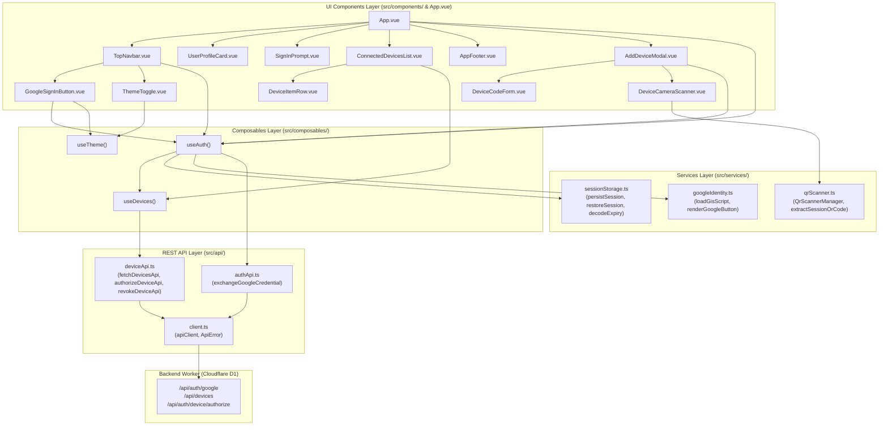

# Frontend Architecture

## 1. Overview

The web dashboard frontend is a high-performance, responsive Single-Page Application (SPA) built with **Vue 3** (Composition API, `<script setup>`), **TypeScript** (strict mode), **Tailwind CSS v4**, **Lucide Icons**, **Reka UI**, and **Vite**.

The codebase enforces a strict separation of concerns following modern frontend engineering principles:
- **Domain Types (`src/types/`)**: Contract definitions for auth and device pairing.
- **API Network Layer (`src/api/`)**: Centralized HTTP client with typed responses and error normalization.
- **Services / Business Logic (`src/services/`)**: Non-reactive business logic, storage drivers, and third-party SDK lifecycles (Google Identity Services, `html5-qrcode`).
- **Composables Layer (`src/composables/`)**: Reactive state controllers that coordinate network and storage operations.
- **UI Components Layer (`src/components/`)**: Single-responsibility presentation components.
- **Styles Layer (`src/styles/`)**: Decoupled stylesheets for theme design tokens and component utility classes.

---

## 2. Directory Structure

```
frontend/
├── index.html
├── package.json
├── tsconfig.app.json
├── tsconfig.json
├── tsconfig.node.json
├── vite.config.ts
├── architecture.md
└── src/
    ├── main.ts                    # Application bootstrapper & theme initialization
    ├── App.vue                    # Root shell layout
    │
    ├── types/                     # Strongly typed domain models & API contracts
    │   ├── auth.ts                # SessionUser, StoredSession, AuthExchangeResponse
    │   ├── device.ts              # DeviceItem, AuthorizeDeviceResult, DevicesResponse
    │   └── gsi.d.ts               # Google Identity Services (GIS) type declarations
    │
    ├── api/                       # Centralized REST network layer
    │   ├── client.ts              # Typed fetch client with ApiError and JSON handling
    │   ├── authApi.ts             # Google credential exchange (/api/auth/google)
    │   └── deviceApi.ts           # Devices query, authorization, and revocation endpoints
    │
    ├── services/                  # Non-reactive business logic & third-party SDK drivers
    │   ├── sessionStorage.ts      # Auth localStorage driver & JWT expiry parsing
    │   ├── googleIdentity.ts      # GIS script loader & Google button renderer
    │   └── qrScanner.ts           # html5-qrcode camera manager & QR payload extractor
    │
    ├── composables/               # Reactive state controllers
    │   ├── useAuth.ts             # User session, login, and sign-out reactive state
    │   ├── useDevices.ts          # Connected mobile devices reactive state & actions
    │   └── useTheme.ts            # Light/Dark/System theme switcher with storage sync
    │
    ├── components/                # Modular UI presentation components
    │   ├── TopNavbar.vue          # Header with logo, navigation links, theme toggle, profile dropdown
    │   ├── AppFooter.vue          # Subtle static footer displaying build git commit version
    │   ├── UserProfileCard.vue    # Welcome card with user photo/initial and email
    │   ├── SignInPrompt.vue       # Unauthenticated callout banner
    │   ├── ConnectedDevicesList.vue# Container for paired mobile devices list
    │   ├── DeviceItemRow.vue      # Individual paired device row with revoke action
    │   ├── AddDeviceModal.vue     # Dialog for pairing new mobile devices
    │   ├── DeviceCodeForm.vue     # 6-character pairing code input form
    │   ├── DeviceCameraScanner.vue# Webcam QR scanner frame with status feedback
    │   ├── GoogleSignInButton.vue # Wrapper rendering Google Identity Services button
    │   └── ThemeToggle.vue        # Dropdown / button toggling light, dark, or system mode
    │
    ├── styles/                    # Decoupled stylesheets
    │   ├── theme.css              # @theme inline tokens, :root and .dark CSS variables
    │   └── components.css         # Navigation link utilities (.nav-link)
    │
    ├── style.css                  # Main stylesheet entry importing theme and components
    └── lib/
        ├── logger.ts              # Scoped console logger with dev-mode guards
        └── utils.ts               # CSS class merger utility (clsx + tailwind-merge)
```

---

## 3. Architecture Layers & Data Flow



### Layer Details

1. **`src/types/` (Domain Types)**
   - **`auth.ts`**: `SessionUser` (user attributes from backend), `StoredSession` (localStorage payload with expiry), `AuthExchangeResponse`.
   - **`device.ts`**: `DeviceItem` (token, paired timestamp, expiry), `AuthorizeDeviceResponse`, `AuthorizeDeviceResult`.

2. **`src/api/` (Network Layer)**
   - **`client.ts`**: Generic `apiClient<T>(path, options)` configuring base URL (`VITE_API_URL` or fallback), setting JSON headers, validating `res.ok`, and mapping errors to `ApiError`.
   - **`authApi.ts`**: `exchangeGoogleCredential(credential)` calling `POST /api/auth/google`.
   - **`deviceApi.ts`**:
     - `fetchDevicesApi(credential)` calling `GET /api/devices`.
     - `authorizeDeviceApi(credential, code, deviceName)` calling `POST /api/auth/device/authorize`.
     - `revokeDeviceApi(credential, token)` calling `DELETE /api/devices/:token`.

3. **`src/services/` (Business Logic & Driver Layer)**
   - **`sessionStorage.ts`**: Safely manages `localStorage` operations for `dashboard.auth.session`. Decodes JWT base64 payloads to determine precise session expiration.
   - **`googleIdentity.ts`**: Dynamically injects Google Identity Services (`gsi/client`), prevents duplicate script tags via a shared promise, and renders the official Google sign-in button.
   - **`qrScanner.ts`**: Wraps `html5-qrcode` in an object-oriented manager (`QrScannerManager`) managing webcam permissions, frames, and URL search parameter extraction.

4. **`src/composables/` (Reactive Controllers)**
   - **`useAuth.ts`**: Reactive singleton holding `user`, `currentCredential`, `isLoggedIn`, `authLoading`, and `authError`. Provides `signIn` and `signOut`.
   - **`useDevices.ts`**: Reactive singleton holding `devices` and `devicesLoading`. Provides `fetchDevices`, `authorizeDevice`, and `revokeDevice`.
   - **`useTheme.ts`**: Manages light, dark, and system theme preferences, synchronizing changes across tabs via the `storage` event and toggling the `dark` class on `document.documentElement`.

5. **`src/components/` (UI Presentation Layer)**
   - **`App.vue`**: Declarative shell displaying `TopNavbar`, `UserProfileCard` or `SignInPrompt`, `ConnectedDevicesList`, and `AppFooter`.
   - **`AppFooter.vue`**: Subtle static footer presenting the build git commit version `v(...)`.
   - **`AddDeviceModal.vue`**: Clean modal container switching between `DeviceCodeForm` (manual 6-char input) and `DeviceCameraScanner` (webcam QR scan).
   - **`ConnectedDevicesList.vue`**: Displays connected devices using `DeviceItemRow` for each device.

6. **`src/styles/` (Modular Styling)**
   - **`theme.css`**: Tailwind CSS v4 `@theme inline` palette mappings, `:root` light mode variables, and `.dark` mode variables.
   - **`components.css`**: Reusable component classes (`.nav-link`, `.nav-link-active`).
   - **`style.css`**: Core entry point importing Google Fonts, Tailwind, animate-css, and child stylesheets.

---

## 4. Key Workflows

### Authentication Flow
1. User clicks the Google Sign-In button rendered by `googleIdentity.ts`.
2. Google returns a signed ID token credential.
3. `useAuth` receives the credential and calls `authApi.exchangeGoogleCredential`.
4. The backend validates the token, provisions the user, and returns user data.
5. `sessionStorage.persistSession` persists the user and credential into `localStorage`.
6. `useDevices.fetchDevices` is triggered immediately to populate connected devices.

### Device Pairing Flow
1. User clicks **Add Device** in `TopNavbar` or `ConnectedDevicesList`.
2. `AddDeviceModal` opens with two options:
   - **6-Character Code**: User inputs the 6-character shortcode shown on their mobile device via `DeviceCodeForm`.
   - **Camera Scanner**: User activates webcam scanner via `DeviceCameraScanner` to scan the QR code displayed on the mobile device.
3. Modal calls `useAuth().authorizeDevice(code, deviceName)`.
4. `deviceApi.authorizeDeviceApi` posts the code with the user's Bearer token to `/api/auth/device/authorize`.
5. On success, `useDevices.fetchDevices` reloads the list, displaying the newly paired device.

---

## 5. Build and Verification Commands

```bash
# Type check and build production bundle
npm run build

# Start local development server
npm run dev

# Preview production build locally
npm run preview
```

