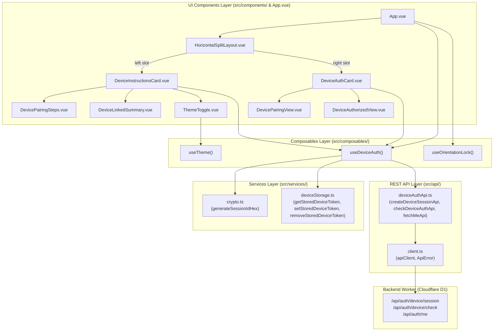
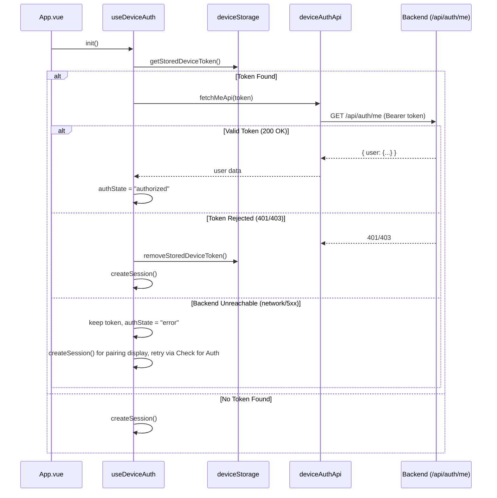

# Mobile Dashboard Architecture

## 1. Overview

The mobile dashboard is a dedicated, landscape-oriented Single-Page Application (SPA) built with **Vue 3** (Composition API, `<script setup>`), **TypeScript** (strict mode), **Tailwind CSS v4**, **Lucide Icons**, **Reka UI**, and **Vite**.

Designed to run on mobile devices or dedicated companion displays, the application pairs with the web dashboard via 32-character hexadecimal cryptographic session tokens, backend-rendered SVG QR codes, and 6-character short pairing codes. Once authorized, it acquires a persistent 6-month access token for continuous API communication.

The codebase enforces strict separation of concerns:
- **Domain Types (`src/types/`)**: Contract definitions for device auth, session status, and layout.
- **API Network Layer (`src/api/`)**: Centralized HTTP client and typed pairing endpoints.
- **Services Layer (`src/services/`)**: Cryptographic session generator and `localStorage` token storage driver.
- **Composables Layer (`src/composables/`)**: Reactive state controllers managing pairing state, orientation lock, and theme.
- **UI Components Layer (`src/components/`)**: Modular presentation components structured around a horizontal split layout.
- **Styles Layer (`src/styles/`)**: Decoupled stylesheets for theme variables and landscape orientation locking rules.

---

## 2. Directory Structure

```
mobile/
├── index.html
├── package.json
├── tsconfig.app.json
├── tsconfig.json
├── tsconfig.node.json
├── vite.config.ts
├── architecture.md
└── src/
    ├── main.ts                    # Application bootstrapper & theme initialization
    ├── App.vue                    # Root shell mounting the horizontal split layout
    │
    ├── types/                     # Strongly typed domain models & API contracts
    │   ├── auth.ts                # UserProfile, AuthState, SessionResponse, CheckAuthResponse, MeResponse
    │   └── layout.ts              # SplitRatio ("50-50" | "30-70" | "70-30")
    │
    ├── api/                       # Centralized REST network layer
    │   ├── client.ts              # Typed fetch client with ApiError and JSON handling
    │   └── deviceAuthApi.ts       # Session creation, auth checking, and /api/auth/me verification
    │
    ├── services/                  # Non-reactive business logic & utilities
    │   ├── crypto.ts              # 32-hex secure random session ID generator (crypto.getRandomValues)
    │   ├── deviceStorage.ts       # LocalStorage driver for mobile device token persistence
    │   ├── weatherApi.ts          # Open-Meteo forecast & air quality client
    │   └── stockApi.ts            # TradingView scanner client with 5m cache & backoff
    │
    ├── composables/               # Reactive state controllers
    │   ├── useDeviceAuth.ts       # Pairing lifecycle, token restore, and reactive status
    │   ├── useOrientationLock.ts  # Screen orientation lock and fullscreen management
    │   ├── useWidgets.ts          # Reactive store for device widgets synced via socket
    │   └── useTheme.ts            # Light/Dark/System theme switcher with storage sync
    │
    ├── components/                # Modular UI presentation components
    │   ├── HorizontalSplitLayout.vue # Dual-panel responsive container with configurable split ratio
    │   ├── VerticalSlidePager.vue # Smooth vertical slide pager with touch, wheel & morphing dots
    │   ├── DeviceLeftPanel.vue    # Left panel coordinating Weather widget & Clock view
    │   ├── DevicePairingSteps.vue # Step 1-4 pairing guide with feedback message banner
    │   ├── DeviceLinkedSummary.vue# Active connection summary and 6-month validity badge (housed in settings modal)
    │   ├── DeviceSettingsModal.vue# Floating settings modal (fullscreen, theme, linked device summary, disconnect, user profile)
    │   ├── DeviceAuthCard.vue     # Right panel coordinating Stock widget, Clock view & pairing
    │   ├── DevicePairingView.vue  # SVG QR code display, 6-char code badge, and copy button
    │   ├── DeviceAuthorizedMinimalView.vue # Multi-mode Clock & synchronization view (Digital, Analog, Calendar)
    │   ├── DeviceAuthorizedView.vue# Authorized profile avatar, name, email, and connection badges
    │   ├── clock/
    │   │   ├── DigitalClockView.vue  # 12h/24h digital clock with animated colons and date badges
    │   │   ├── AnalogClockView.vue   # SVG analog dial with smooth 60fps sweep / mechanical tick and date window
    │   │   └── MonthCalendarView.vue # Interactive monthly calendar grid with month/year navigation and Today reset
    │   ├── widgets/
    │   │   ├── WeatherWidget.vue  # Full weather display with multi-city horizontal swipe animation, live condition mapping, and interactive FX preview
    │   │   ├── WeatherEffects.vue # GPU-accelerated atmospheric visual shaders (sunlight, day/night rain, cloud, sandstorm, snow, chilly night)
    │   │   └── StockWidget.vue    # Full stock display with live quotes, multi-period performance dropdown (1D to 1Y from API), day range, metrics grid
    │   └── ThemeToggle.vue        # Dropdown / button toggling light, dark, or system mode
    │
    ├── styles/                    # Decoupled stylesheets
    │   ├── theme.css              # @theme inline tokens, :root and .dark CSS variables
    │   └── orientation.css        # .orientation-locked-container & portrait 90deg transform
    │
    ├── style.css                  # Main stylesheet entry importing theme and orientation rules
    └── lib/
        ├── logger.ts              # Scoped console logger with dev-mode guards
        └── utils.ts               # CSS class merger utility (clsx + tailwind-merge)
```

---

## 3. Architecture Layers & Data Flow



### Layer Details

1. **`src/types/` (Domain Types)**
   - **`auth.ts`**:
     - `UserProfile`: `id`, `email`, `name`, `picture_url`.
     - `AuthState`: `"idle" | "loading" | "pending" | "checking" | "authorized" | "expired" | "error"`.
     - `SessionResponse`: `session_id`, `short_code`, `qr_svg`, `expires_at`.
     - `CheckAuthResponse`: `status`, `token`, `user`.
     - `MeResponse`: `user`.
   - **`layout.ts`**: `SplitRatio` union (`"50-50" | "30-70" | "70-30"`).

2. **`src/api/` (Network Layer)**
   - **`client.ts`**: Centralized HTTP fetch client reading `VITE_API_URL`, applying JSON content type headers, verifying response status, and normalizing errors.
   - **`deviceAuthApi.ts`**:
     - `createDeviceSessionApi(sessionId)`: Calls `POST /api/auth/device/session`.
     - `checkDeviceAuthApi(sessionId)`: Calls `POST /api/auth/device/check`.
     - `fetchMeApi(token)`: Calls `GET /api/auth/me` with `Authorization: Bearer <token>`.

3. **`src/services/` (Business Logic & Driver Layer)**
   - **`crypto.ts`**: Uses `crypto.getRandomValues(new Uint8Array(16))` to generate a 32-hex random string matching backend cryptographic requirements.
   - **`deviceStorage.ts`**: Reads, writes, and removes `dashboard.mobile.device_token` in `localStorage` with fail-safe error handling.

4. **`src/composables/` (Reactive Controllers)**
   - **`useDeviceAuth.ts`**: Manages the full pairing lifecycle. Displays the backend's canonical `short_code` (with a local `deriveShortCode` fallback), tracks `authState`, restores saved tokens via `restoreExistingToken` (clears storage only on 401/403; keeps the token and offers retry on network errors), initializes sessions via `createSession`, re-verifies saved tokens first inside `checkAuth`, and cleans up tokens via `disconnect`.
   - **`useOrientationLock.ts`**: Monitors screen orientation and document fullscreen state. Requests `screen.orientation.lock("landscape")` when supported and provides `toggleFullscreen`.
   - **`useTheme.ts`**: Weather-driven adaptive theme controller (`syncWeatherTheme`). Automatically sets Light mode during daytime weather and Dark mode during nighttime or dark severe storms (thunderstorms, duststorms), with a local solar time fallback (6 AM - 6 PM) and zero manual UI toggles.

5. **`src/components/` (UI Presentation Layer)**
   - **`HorizontalSplitLayout.vue`**: Configurable dual-pane layout maintaining responsive width ratios and safe-area padding.
   - **`DeviceInstructionsCard.vue`**: Left pane showing `DeviceLinkedSummary` if authorized, or `DevicePairingSteps` if unlinked, with a Check for Auth button.
   - **`DeviceAuthCard.vue`**: Right pane displaying `DeviceAuthorizedView` if linked, or `DevicePairingView` showing the QR code (backend SVG rendered through `` so embedded scripts cannot execute), the canonical 6-char pairing code, and a live countdown from `expires_at`. The expired overlay takes precedence over the QR image; error/idle states get their own retry/placeholder blocks.

6. **`src/styles/` (Modular Styling)**
   - **`theme.css`**: Tailwind CSS v4 color tokens and dark mode overrides.
   - **`orientation.css`**: Defines `.orientation-locked-container` which applies a 90-degree CSS rotation and fixed positioning when the device is held in portrait mode to guarantee a landscape experience.

---

## 4. Key Workflows

### 1. App Startup & Token Restoration


### 2. Session Creation & Pairing Check
1. `useDeviceAuth.createSession` generates a 32-hex session ID using `crypto.generateSessionIdHex()`.
2. Calls `deviceAuthApi.createDeviceSessionApi(sessionId)`.
3. Backend returns the SVG QR code, 6-character short code, and 15-minute expiration timestamp.
4. `DevicePairingView` renders the SVG QR code and displays the 6-character short code.
5. User pairs the device from their web dashboard.
6. Mobile user clicks **Check for Auth** (or polling triggers `checkAuth()`).
7. `deviceAuthApi.checkDeviceAuthApi(sessionId)` returns status `"authorized"` with a 6-month token and user details.
8. Token is persisted in `localStorage` via `deviceStorage.setStoredDeviceToken`.
9. View automatically transitions to `DeviceAuthorizedView` displaying the user profile.
10. `useDeviceAuth` establishes a live WebSocket connection via `deviceSocketUrl(token)` to `/api/devices/ws/:token`.

### 3. Self-Disconnect (backend-confirmed)
1. Tapping **Disconnect Device** (in the left box) opens a two-step confirmation in the left box; no request runs yet.
2. On confirm, `useDeviceAuth.disconnect()` calls `disconnectDeviceApi` — `DELETE /api/devices/:token` with the device token as bearer — and waits.
3. Only after the backend confirms (already-gone 401/403/404 counts as confirmed) does it close the socket, wipe `dashboard.mobile.device_token`, and start a fresh pairing session. On network/5xx failure it stays authorized, keeps the token, and shows a retry error in the left box confirmation panel.
4. The backend deletes the D1 row first, then pokes the device object and the user's live hub, so an open web dashboard removes the row immediately.

### 4. Real-Time Revocation Handling
1. When the user revokes the device on the web dashboard, the backend triggers `DeviceObject`'s `/revoke` endpoint.
2. `DeviceObject` pushes `{"status": "revoked", "message": "Device access was revoked from the web dashboard."}` over the active WebSocket and closes the socket.
3. Mobile's `deviceSocket.onmessage` receives the revocation payload.
4. Mobile clears `dashboard.mobile.device_token` from `localStorage`, sets `user` to `null`, and resets `authState` to `"idle"`.
5. Mobile automatically calls `createSession()` to initiate a fresh pairing handshake (rendering a new QR code and shortcode).
6. The UI displays the notification banner: `"Device access was revoked from the web dashboard. Scan QR code to reconnect."`

---

## 5. Build and Verification Commands

```bash
# Type check and build production bundle
npm run build

# Type check only (no emit)
npm run typecheck

# Start local development server (port 5174)
npm run dev

# Preview production build locally
npm run preview
```

