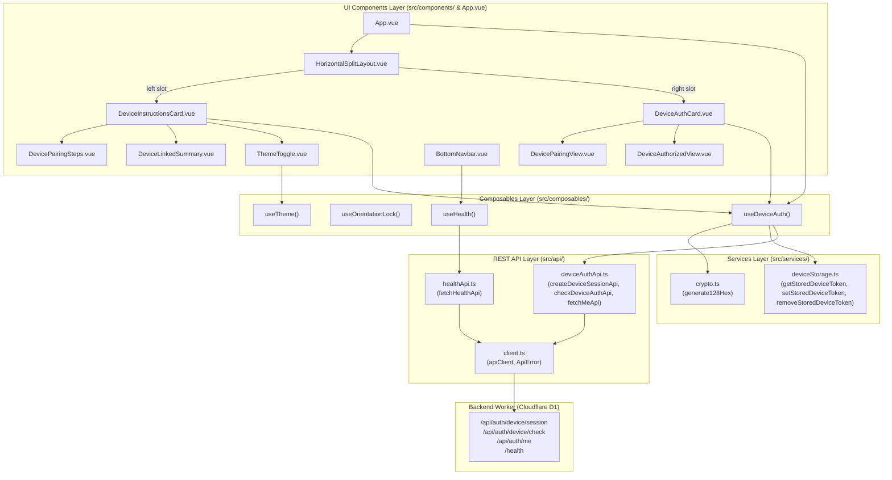
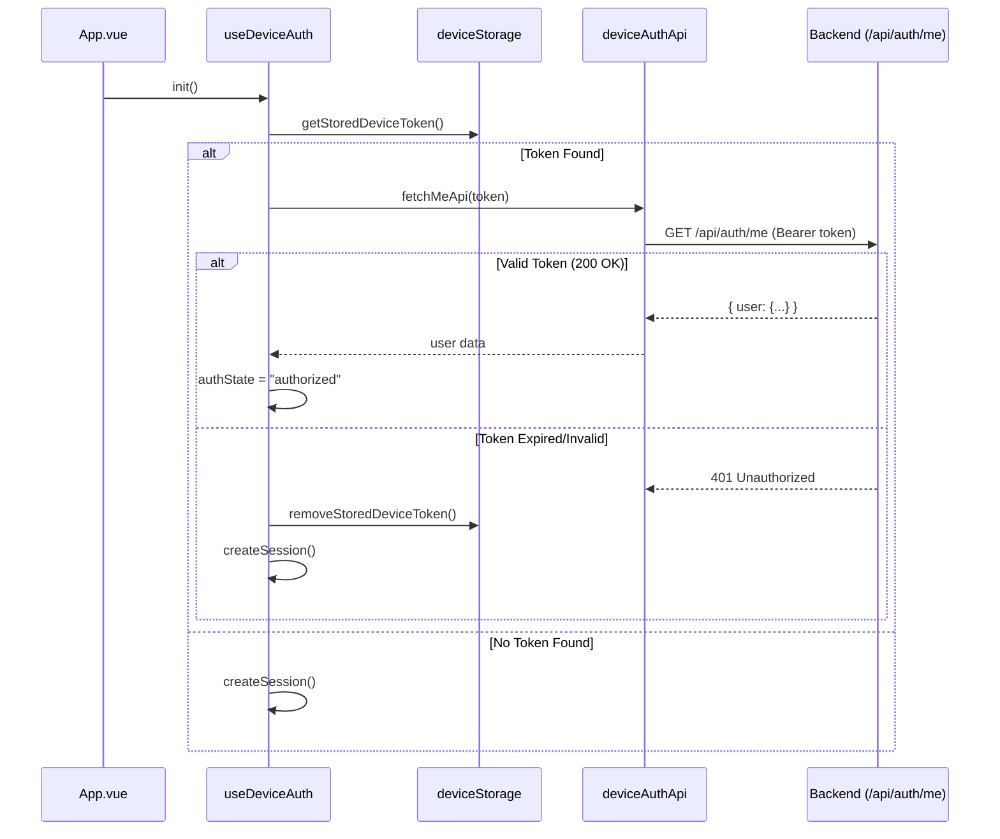

# Mobile Dashboard Architecture

## 1. Overview

The mobile dashboard is a dedicated, landscape-oriented Single-Page Application (SPA) built with **Vue 3** (Composition API, `<script setup>`), **TypeScript** (strict mode), **Tailwind CSS v4**, **Lucide Icons**, **Reka UI**, and **Vite**.

Designed to run on mobile devices or dedicated companion displays, the application pairs with the web dashboard via 128-character hexadecimal cryptographic session tokens, backend-rendered SVG QR codes, and 6-character short pairing codes. Once authorized, it acquires a persistent 6-month access token for continuous API communication.

The codebase enforces strict separation of concerns:
- **Domain Types (`src/types/`)**: Contract definitions for device auth, session status, layout, and health.
- **API Network Layer (`src/api/`)**: Centralized HTTP client and typed pairing endpoints.
- **Services Layer (`src/services/`)**: Cryptographic session generator and `localStorage` token storage driver.
- **Composables Layer (`src/composables/`)**: Reactive state controllers managing pairing state, orientation lock, and theme.
- **UI Components Layer (`src/components/`)**: Modular presentation components structured around a horizontal split layout.
- **Styles Layer (`src/styles/`)**: Decoupled stylesheets for theme variables and landscape orientation locking rules.

---

## 2. Directory Structure

```
mobile/
├── index.html
├── package.json
├── tsconfig.app.json
├── tsconfig.json
├── tsconfig.node.json
├── vite.config.ts
├── architecture.md
└── src/
    ├── main.ts                    # Application bootstrapper & theme initialization
    ├── App.vue                    # Root shell mounting the horizontal split layout
    │
    ├── types/                     # Strongly typed domain models & API contracts
    │   ├── auth.ts                # UserProfile, AuthState, SessionResponse, CheckAuthResponse, MeResponse
    │   ├── layout.ts              # SplitRatio ("50-50" | "30-70" | "70-30")
    │   └── health.ts              # HealthResponse
    │
    ├── api/                       # Centralized REST network layer
    │   ├── client.ts              # Typed fetch client with ApiError and JSON handling
    │   ├── deviceAuthApi.ts       # Session creation, auth checking, and /api/auth/me verification
    │   └── healthApi.ts           # Backend health check endpoint (/health)
    │
    ├── services/                  # Non-reactive business logic & utilities
    │   ├── crypto.ts              # 128-hex secure random session ID generator (crypto.getRandomValues)
    │   └── deviceStorage.ts       # LocalStorage driver for mobile device token persistence
    │
    ├── composables/               # Reactive state controllers
    │   ├── useDeviceAuth.ts       # Pairing lifecycle, token verification, and reactive status
    │   ├── useHealth.ts           # Backend connectivity polling
    │   ├── useOrientationLock.ts  # Screen orientation lock and fullscreen management
    │   └── useTheme.ts            # Light/Dark/System theme switcher with storage sync
    │
    ├── components/                # Modular UI presentation components
    │   ├── HorizontalSplitLayout.vue # Dual-panel responsive container with configurable split ratio
    │   ├── DeviceInstructionsCard.vue# Left panel coordinating pairing instructions & link summary
    │   ├── DevicePairingSteps.vue # Step 1-4 pairing guide with feedback message banner
    │   ├── DeviceLinkedSummary.vue# Active connection summary and 6-month validity badge
    │   ├── DeviceAuthCard.vue     # Right panel coordinating pairing view & authorized profile
    │   ├── DevicePairingView.vue  # SVG QR code display, 6-char code badge, and copy button
    │   ├── DeviceAuthorizedView.vue# Authorized profile avatar, name, email, and disconnect button
    │   ├── BottomNavbar.vue       # Status indicator pill showing backend connection & release
    │   └── ThemeToggle.vue        # Dropdown / button toggling light, dark, or system mode
    │
    ├── styles/                    # Decoupled stylesheets
    │   ├── theme.css              # @theme inline tokens, :root and .dark CSS variables
    │   └── orientation.css        # .orientation-locked-container & portrait 90deg transform
    │
    ├── style.css                  # Main stylesheet entry importing theme and orientation rules
    └── lib/
        ├── logger.ts              # Scoped console logger with dev-mode guards
        └── utils.ts               # CSS class merger utility (clsx + tailwind-merge)
```

---

## 3. Architecture Layers & Data Flow



### Layer Details

1. **`src/types/` (Domain Types)**
   - **`auth.ts`**:
     - `UserProfile`: `id`, `email`, `name`, `picture_url`.
     - `AuthState`: `"idle" | "loading" | "pending" | "checking" | "authorized" | "expired" | "error"`.
     - `SessionResponse`: `session_id`, `short_code`, `qr_svg`, `expires_at`.
     - `CheckAuthResponse`: `status`, `token`, `user`.
     - `MeResponse`: `user`.
   - **`layout.ts`**: `SplitRatio` union (`"50-50" | "30-70" | "70-30"`).
   - **`health.ts`**: `HealthResponse` (`status`, `release`, `now`).

2. **`src/api/` (Network Layer)**
   - **`client.ts`**: Centralized HTTP fetch client reading `VITE_API_URL`, applying JSON content type headers, verifying response status, and normalizing errors.
   - **`deviceAuthApi.ts`**:
     - `createDeviceSessionApi(sessionId)`: Calls `POST /api/auth/device/session`.
     - `checkDeviceAuthApi(sessionId)`: Calls `POST /api/auth/device/check`.
     - `fetchMeApi(token)`: Calls `GET /api/auth/me` with `Authorization: Bearer <token>`.
   - **`healthApi.ts`**: `fetchHealthApi()` calling `GET /health`.

3. **`src/services/` (Business Logic & Driver Layer)**
   - **`crypto.ts`**: Uses `crypto.getRandomValues(new Uint8Array(64))` to generate a 128-hex random string matching backend cryptographic requirements.
   - **`deviceStorage.ts`**: Reads, writes, and removes `dashboard.mobile.device_token` in `localStorage` with fail-safe error handling.

4. **`src/composables/` (Reactive Controllers)**
   - **`useDeviceAuth.ts`**: Manages the full pairing lifecycle. Computes the 6-character `shortCode`, tracks `authState`, checks for existing tokens via `restoreExistingToken`, initializes sessions via `createSession`, polls status via `checkAuth`, and cleans up tokens via `disconnect`.
   - **`useOrientationLock.ts`**: Monitors screen orientation and document fullscreen state. Requests `screen.orientation.lock("landscape")` when supported and provides `toggleFullscreen`.
   - **`useHealth.ts`**: Polls backend connectivity every 2000ms.
   - **`useTheme.ts`**: Controls theme switching and syncs with OS preference.

5. **`src/components/` (UI Presentation Layer)**
   - **`HorizontalSplitLayout.vue`**: Configurable dual-pane layout maintaining responsive width ratios and safe-area padding.
   - **`DeviceInstructionsCard.vue`**: Left pane showing `DeviceLinkedSummary` if authorized, or `DevicePairingSteps` if unlinked, with a Check for Auth button.
   - **`DeviceAuthCard.vue`**: Right pane displaying `DeviceAuthorizedView` if linked, or `DevicePairingView` showing the SVG QR code and 6-char pairing code.

6. **`src/styles/` (Modular Styling)**
   - **`theme.css`**: Tailwind CSS v4 color tokens and dark mode overrides.
   - **`orientation.css`**: Defines `.orientation-locked-container` which applies a 90-degree CSS rotation and fixed positioning when the device is held in portrait mode to guarantee a landscape experience.

---

## 4. Key Workflows

### 1. App Startup & Token Restoration


### 2. Session Creation & Pairing Check
1. `useDeviceAuth.createSession` generates a 128-hex session ID using `crypto.generate128Hex()`.
2. Calls `deviceAuthApi.createDeviceSessionApi(sessionId)`.
3. Backend returns the SVG QR code, 6-character short code, and 15-minute expiration timestamp.
4. `DevicePairingView` renders the SVG QR code and displays the 6-character short code.
5. User pairs the device from their web dashboard.
6. Mobile user clicks **Check for Auth** (or polling triggers `checkAuth()`).
7. `deviceAuthApi.checkDeviceAuthApi(sessionId)` returns status `"authorized"` with a 6-month token and user details.
8. Token is persisted in `localStorage` via `deviceStorage.setStoredDeviceToken`.
9. View automatically transitions to `DeviceAuthorizedView` displaying the user profile.

---

## 5. Build and Verification Commands

```bash
# Type check and build production bundle
npm run build

# Start local development server (port 5174)
npm run dev

# Preview production build locally
npm run preview
```

